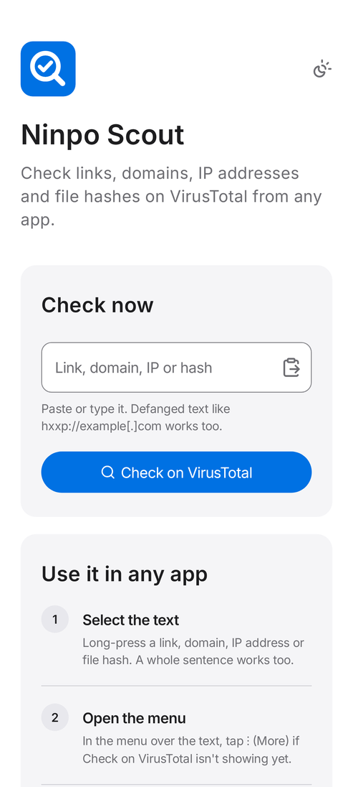
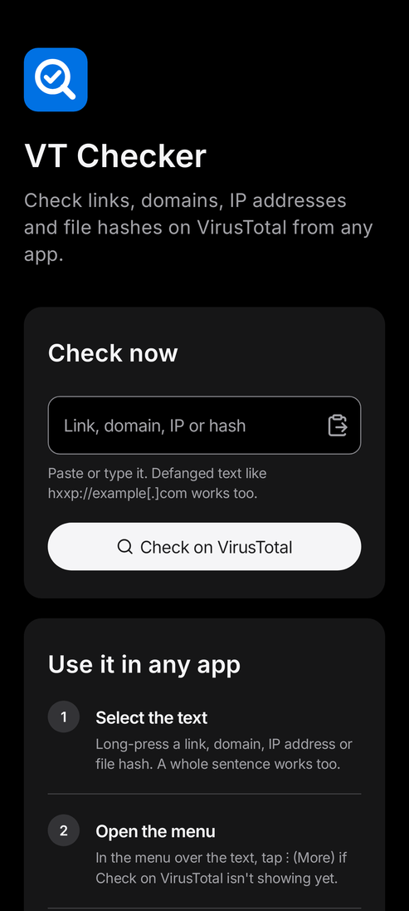
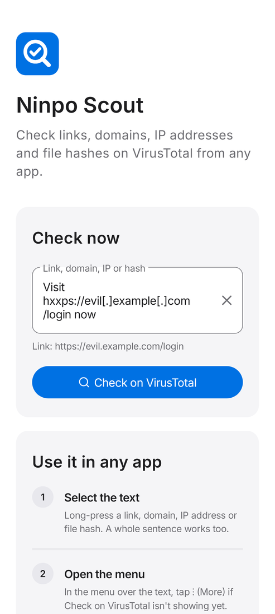
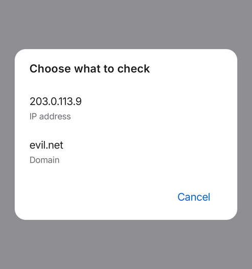
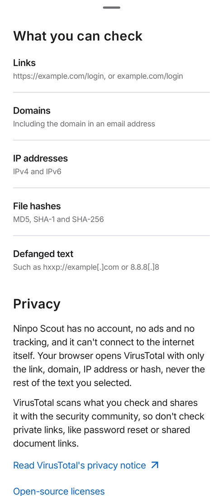

# Ninpo Scout

An Android app by Ninpo Inc. that adds **Check on VirusTotal** to the text-selection menu and the Share sheet. Select a link, domain, IP address or file hash in any app, choose Check on VirusTotal, and its VirusTotal report opens over the app you were in.

<p>
  
  
  
</p>

## Download

Get the latest APK from the [Releases page](../../releases) and open it on your phone; Android asks once to allow installs from the app you opened it with. Ninpo Scout needs Android 8.0 or later. What changed in each version is in the [changelog](CHANGELOG.md).

## What it does

- **Works from any app.** Long-press text, open the selection menu (⋮ on many phones), tap Check on VirusTotal. Sharing a link to the app works too, and so does long-pressing the app icon and tapping **Check copied text**.
- **Report over the app you're in.** In Chrome 107 and later the VirusTotal report opens as a resizable sheet with the app still visible above it; other browsers show it full screen. Closing it returns to where you were.
- **Finds what to check in messy text.** A sentence, a log line or an email header is fine: the app picks out links, domains, IPv4 and IPv6 addresses and MD5, SHA-1 and SHA-256 hashes. When there are several it asks which one; when there are none it says so instead of opening an empty search.
- **Reads defanged text.** `hxxps://evil[.]example[.]com`, `8.8.8[.]8` and `user[at]evil[.]com` are cleaned up before checking.
- **Check field on the home screen.** Paste or type, and the line under the field shows exactly what will be checked. Clipboard text that a password manager marks as private is never pasted.
- **Opens reports sooner when it can.** While you're choosing from the list, reading the first-check notice or typing in the home screen field, the app starts your browser in the background (Custom Tabs warm-up, which Chrome says can save up to 700 ms). It never pre-loads the VirusTotal page, because that would send the item before you tap.
- **Short home screen.** The check field, three steps and a privacy summary; the full details are one tap away in a bottom sheet.
- **Light and dark mode.** It follows the phone by default; the button at the top right switches between Match device, Light and Dark, and the choice is remembered. Also large-text support, TalkBack labels and 48dp touch targets.

<p>
  
  
</p>

## Privacy

The app has no account, no ads, no analytics and no permissions, including no internet permission. It opens VirusTotal's website in the user's browser (as a Custom Tab), sending only the item it found, never the rest of the selected text. To do that it looks up which browser is installed; that stays on the phone. Before the first check it explains that VirusTotal scans what it is asked about and shares it with the security community, as VirusTotal's [documentation](https://docs.virustotal.com/docs/searching) states.

## How the VirusTotal link works

The app does not use VirusTotal's API. It opens the same address VirusTotal's own search box uses:

```
https://www.virustotal.com/gui/search?query=<percent-encoded item>
```

VirusTotal redirects that to the right report (`/gui/url/…`, `/gui/domain/…`, `/gui/ip-address/…`, `/gui/file/…`). Links typed without a scheme get `http://` added, which is what VirusTotal's own URL scanner does. Version 1.0 used `/gui/search/<item>` in the path, which VirusTotal now answers with "page does not exist" for full URLs. These behaviors were checked against virustotal.com in November 2026; if VirusTotal changes them, `VirusTotal.java` is the one place to update.

## Project layout

| Path | What it is |
|---|---|
| `app/src/main/java/com/ninpo/scout/IndicatorParser.java` | Finds and cleans up links, domains, IPs and hashes in text |
| `app/src/main/java/com/ninpo/scout/Tlds.java` | IANA top-level domain list, so `config.yaml` isn't mistaken for a domain (generated by `scripts/update_tlds.py`) |
| `app/src/main/java/com/ninpo/scout/VirusTotal.java` | Builds the VirusTotal address |
| `app/src/main/java/com/ninpo/scout/CheckActivity.java` | The text-selection and Share handler (no screen of its own) |
| `app/src/main/java/com/ninpo/scout/CheckFlow.java` | Choosing an item, the first-check notice, opening the Custom Tab |
| `app/src/main/java/com/ninpo/scout/BrowserWarmup.java` | Starts the browser early while the user decides |
| `app/src/main/java/com/ninpo/scout/MainActivity.java` | Home screen |
| `app/src/main/java/com/ninpo/scout/DetailsSheet.java` | The "More details" sheet: formats, privacy, licenses |
| `app/src/main/java/com/ninpo/scout/Appearance.java`, `ScoutApp.java` | The Match device / Light / Dark setting, saved and re-applied at launch |
| `app/src/main/res/values/colors.xml`, `values-night/colors.xml` | Light and dark color tokens |

The design is Apple-inspired: matched light and dark color tokens, Apple's type scale and spacing, the Inter typeface, one pill button style, and WCAG 2.2 AA contrast in both themes.

## Building

Requires Android Studio (or JDK 17+ and the Android SDK with platform 36).

```
./gradlew assembleDebug          # debug APK
./gradlew assembleRelease        # release APK, shrunk with R8 (sign it with Ninpo's key)
./gradlew bundleRelease          # App Bundle: the format Google Play requires for new apps
./gradlew testDebugUnitTest      # unit and Robolectric tests
./gradlew lintDebug              # Android lint
./gradlew testDebugUnitTest -Pscreenshots --tests '*ScreenshotTest'
                                 # renders screens to app/build/screenshots/
```

Every push to a branch runs the tests and lint and builds the app (`.github/workflows/build.yml`). Each run attaches a test APK: open the Actions tab, pick the run and download it under Artifacts.

The application ID is `com.ninpo.scout`. It can't change once the app is on Google Play. Version 1.0 was called VT Checker and used `com.example.vtchecker`, so phones with that build will show two apps until the old one is removed.

## Releasing a new version

1. Raise `versionCode` and `versionName` in `app/build.gradle.kts`.
2. Add a `## <version>` section at the top of [`CHANGELOG.md`](CHANGELOG.md). It becomes the release notes.
3. Tag the commit with the version and push the tag: `git tag 2.1 && git push origin 2.1`.

GitHub then tests and builds the app and publishes the release with the APK attached (`.github/workflows/release.yml`).

**Signing.** Add four repository secrets under Settings > Secrets and variables > Actions: `SIGNING_KEYSTORE_BASE64` (the keystore file encoded with `base64 -w0 release.jks` on Linux or `base64 -i release.jks` on macOS), `SIGNING_STORE_PASSWORD`, `SIGNING_KEY_ALIAS` and `SIGNING_KEY_PASSWORD`. With them, releases carry an APK signed with Ninpo's key, and the signed App Bundle for Google Play is kept with the workflow run. Without them, a release carries a test build signed with a temporary key and is marked as a pre-release; after adding the secrets, run the Release workflow again on the same tag from the Actions tab to replace it. Keep the keystore safe and backed up: Android only installs updates signed with the same key.

## Maintenance

- **New top-level domains.** `.github/workflows/update-tlds.yml` runs `scripts/update_tlds.py` on the 1st of each month and proposes an update when IANA's list changes. To get a pull request rather than an issue, tick Settings > Actions > General > "Allow GitHub Actions to create and approve pull requests". Checks don't start on their own for a pull request a workflow opened; approve them in the pull request.
- **Fonts.** Inter is subset to Latin, Vietnamese and common symbols, which cut each font file from 325 KB to 133 KB. Other scripts use Android's system fonts. To change the subset, rerun `pyftsubset` (fontTools) on the original Inter files.
- **Android Gradle Plugin 9.** The project stays on AGP 8.13 so it opens in current Android Studio releases without the AGP 9 migration. Moving to AGP 9 and compile SDK 37 is a separate step.

## Licenses

Inter (SIL Open Font License 1.1, subset), Lucide and Feather icons (ISC and MIT), AndroidX and Material Components (Apache 2.0). The full texts ship in the app under Open-source licenses.

Ninpo Scout is not affiliated with or endorsed by VirusTotal.
